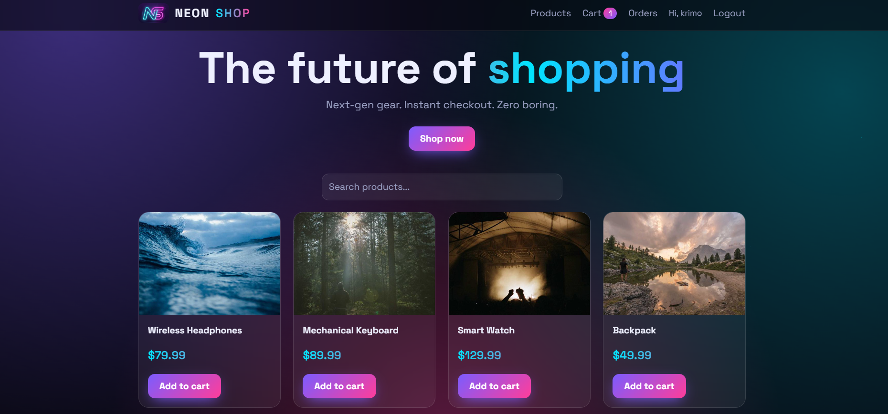
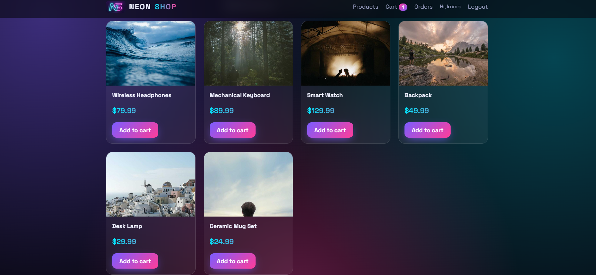
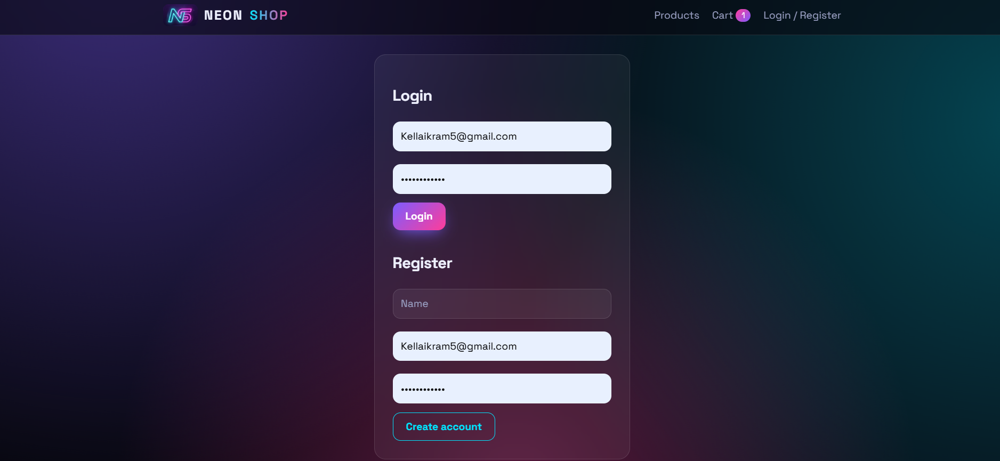
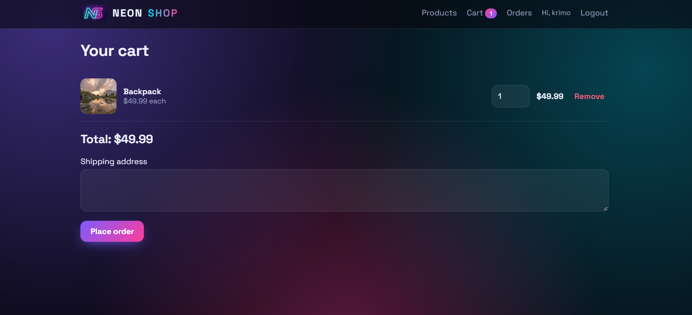
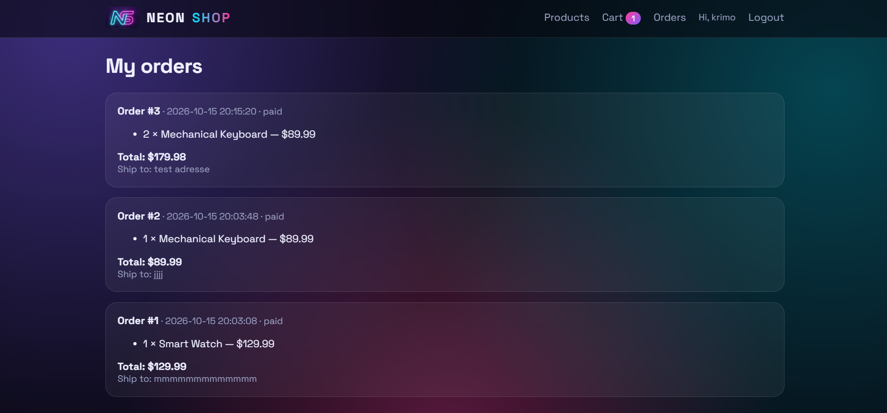

# NeonShop — Full-Stack E-Commerce Store

> **CodeAlpha Full Stack Development Internship — Task 1: Simple E-commerce Store**

A complete e-commerce web app: product listings, product details, shopping cart, user registration/login and order processing, backed by a real database.

## Screenshots

| Home | Product details |
|---|---|
|  |  |
|---|---|

| Cart | Orders |
|---|---|
|  |  |

## Features

- Product listing with live search
- Product details page (image, price, description, stock)
- Shopping cart (add, change quantity, remove, persists across refreshes)
- User registration and login (bcrypt password hashing + JWT)
- Checkout with shipping address and order history
- Server-side order processing: totals are computed from database prices, stock is checked and updated inside a transaction
- Animated neon UI (glassmorphism, 3D card tilt, toasts) — pure HTML, CSS and JavaScript
- Automated API test suite (16 tests)

## Tech stack

| Layer | Technology |
|---|---|
| Frontend | HTML, CSS, vanilla JavaScript |
| Backend | Node.js, Express.js |
| Database | SQLite (built-in `node:sqlite`) |
| Auth | JSON Web Tokens, bcryptjs |
| Tests | Node's built-in test runner |

## Getting started

**Requirements:** Node.js **22.5 or newer**.

```bash
git clone https://github.com/Kellaikram/CodeAlpha_EcommerceStore.git
cd CodeAlpha_EcommerceStore
npm install
npm start
```

Open **http://localhost:3000**. The database (`store.db`) and six sample products are created automatically on first run.

Optional environment variables:

| Variable | Default | Purpose |
|---|---|---|
| `PORT` | `3000` | Server port |
| `JWT_SECRET` | dev value | **Set a long random value in production** |
| `DB_FILE` | `store.db` | SQLite file path |

## Project structure

```
├── server.js              # Express app and route mounting
├── db.js                  # SQLite schema + seed data
├── middleware/auth.js     # JWT signing and verification
├── routes/
│   ├── auth.js            # register, login, me
│   ├── products.js        # list/search, details
│   └── orders.js          # checkout, order history
├── public/                # frontend (HTML, CSS, JS)
├── tests/api.test.js      # backend API tests
└── screenshots/
```

## API

| Method | Route | Auth | Description |
|---|---|---|---|
| GET | `/api/products?q=` | – | List / search products |
| GET | `/api/products/:id` | – | Product details |
| POST | `/api/auth/register` | – | Create account |
| POST | `/api/auth/login` | – | Log in, returns token |
| GET | `/api/auth/me` | ✔ | Current user |
| POST | `/api/orders` | ✔ | Place an order `{ items: [{id, qty}], address }` |
| GET | `/api/orders` | ✔ | My order history |

## Database schema

`users` → `orders` → `order_items` ← `products`

## Running the tests

```bash
npm test
```

The suite starts the server on port 3999 with a temporary database and checks every route: products, auth, validation errors, order totals, stock updates, price-tampering protection and order isolation between users.

## Notes

- Payments are simulated: orders are marked `paid` without charging anyone.
- For production, move the JWT to httpOnly cookies and add rate limiting and CSRF protection.

## Author

Kella Ikram — CodeAlpha Full Stack Development Intern
🔗 LinkedIn: ikram-kella
